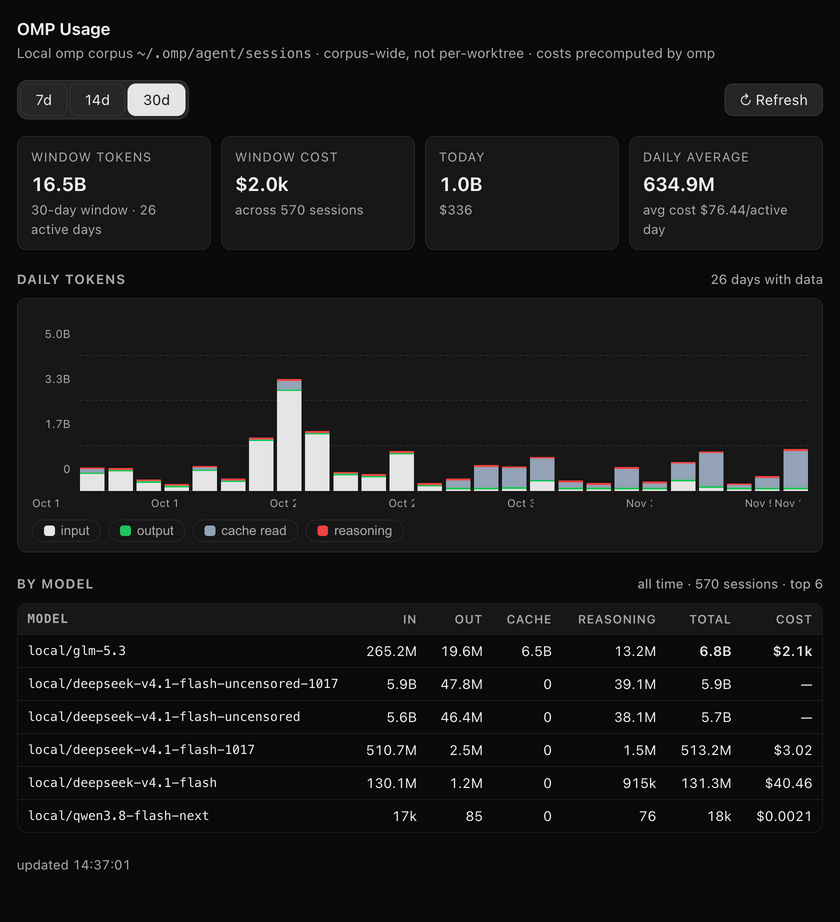

# OMP Usage (Orca plugin)

A token-usage dashboard for the local [omp](https://omp.sh) CLI corpus — the plugin
form of the omp usage provider from
[stablyai/orca PR #36454](https://github.com/stablyai/orca/pull/36454).




## What it does

- **Status bar item** — today's corpus token total and cost (e.g. `899.4M tok`), a
  tooltip with the exact numbers, refreshed on load and every 15 minutes;
- **OMP Usage panel** (right sidebar, `bar-chart-3` icon):
  - KPI strip: window tokens / window cost / today / daily average, each with its
    active-days context;
  - stacked daily token chart (pure CSS grid, no chart library) with a y-axis,
    gridlines, hover and keyboard-focusable tooltips per day, and pill-shaped
    series toggles — hide a series (say, dominant cache reads) and the chart
    rescales to what remains;
  - 7/14/30-day windows; per-model table (input / output / cache / reasoning /
    total / cost / sessions) over the whole corpus;
  - live scan progress badge while a rescan actually runs, with self-healing
    when the worker restarts.

## Scope and setup

**This plugin tracks the omp CLI only.** It reads the transcripts omp itself writes
(`~/.omp/agent/sessions`), where each assistant message already carries a `usage`
block with per-message token counts and a **precomputed cost**. Because of that:

- **Any provider omp can use works for free** — the plugin never calls a pricing
  API. Cloud providers (OpenAI, Anthropic, …), local routers, custom gateways:
  whatever strings omp records as `provider`/`model` are shown as-is, and the
  cost column sums what omp already computed. Verified by fixture tests against
  synthetic transcripts with multiple cloud providers and zero-cost local
  routers (`node test/worker-fixtures.mjs`).
- **A session that switches models is attributed exactly**: every usage block is
  counted under the model of its own message, so per-model costs stay exact.
- **No pricing → `—`**: when omp records `cost.total` as 0 (typical for local
  models and self-hosted routers), the table shows `—` instead of a misleading
  `$0`, and those tokens don't contribute to cost totals.
- **Other agent CLIs (Claude Code, Codex, …) are not covered.** Their usage lives
  in Orca's built-in Settings → Stats & Usage, which already has stores for
  them; this plugin adds the missing omp provider.

**Zero configuration.** No settings, no API keys, no setup steps: install the
plugin, and if `~/.omp/agent/sessions` exists on this machine, the dashboard
fills itself (the first scan of a large corpus shows a progress badge; later
scans are incremental). If omp has never run here, the panel says so and points
to the corpus path. Nothing is pulled from "your harnesses" — the omp corpus is
the single data source.

## Where the data comes from

`~/.omp/agent/sessions/**/*.jsonl` — omp transcripts that already carry a
`usage` block per assistant message, with cost precomputed. The plugin keeps a
per-file size+mtime checkpoint cache under
`~/.omp/agent/orca-plugins/omp-usage/`, so unchanged sessions are never
re-parsed. Totals are corpus-wide (not per-worktree); reasoning tokens are kept
separate from output. The panel says so explicitly.

## Install

Requires Orca >= 1.4.255 (desktop app).

```sh
orca plugin dev load /path/to/orca-usage-plugin
# approval_required → re-run with --approve <fingerprint> from the output
```

Or list it in a catalog / install from a Git repository whose owner matches the
publisher you want. The plugin is fully self-contained: `node:*` imports only,
no build step, no other plugin, no network access.

## Capabilities

| Capability | Why |
| --- | --- |
| `storage:own` | Persist the scan checkpoint cache |
| `notifications:show` | (reserved) user-facing refresh notices |

The status bar item and panel run from a `trusted-worker`; the manifest is
[`orca-plugin.json`](orca-plugin.json).

## Verified

- `node test/worker-fixtures.mjs` — fixture tests against a fake HOME: multiple
  cloud providers summed exactly (tokens, reasoning, cacheWrite, costs),
  zero-cost records contribute tokens but no cost, corrupt lines and non-usage
  records ignored, per-model attribution exact across mid-session model
  switches, checkpoint cache reuse, appended records picked up, empty corpus
  and missing `~/.omp` handled without a crash;
- live in Orca 1.4.255: worker scans 590+ session files, 570+ sessions cached;
  the panel renders with real data (`orca plugin shot`);
- interactive: series toggles rescale the chart (verified via DOM tests),
  tooltips on hover and focus, 7/14/30-day windows re-query, the empty state
  (no omp corpus) explains itself and points at the corpus path;
- manual: Refresh rescans and updates the status bar; worker restart is
  retried with backoff by the panel.